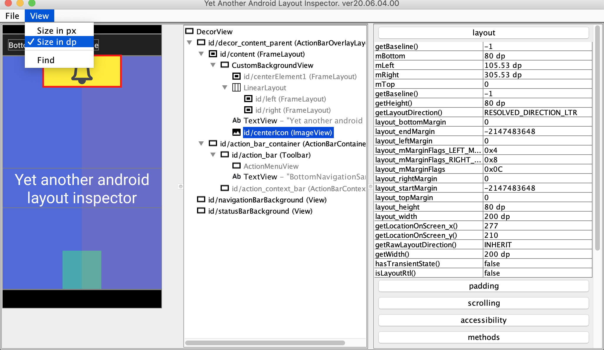
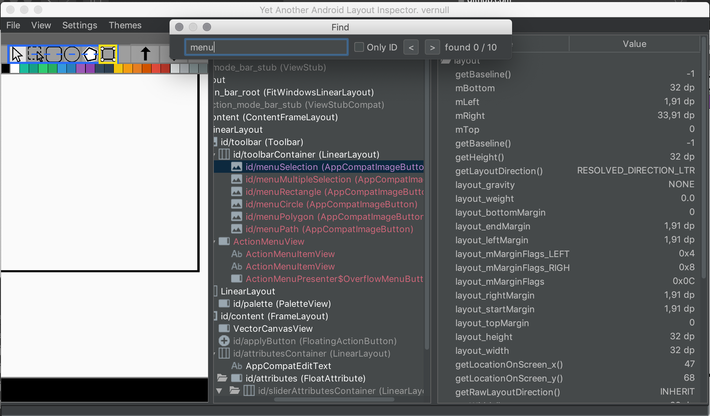
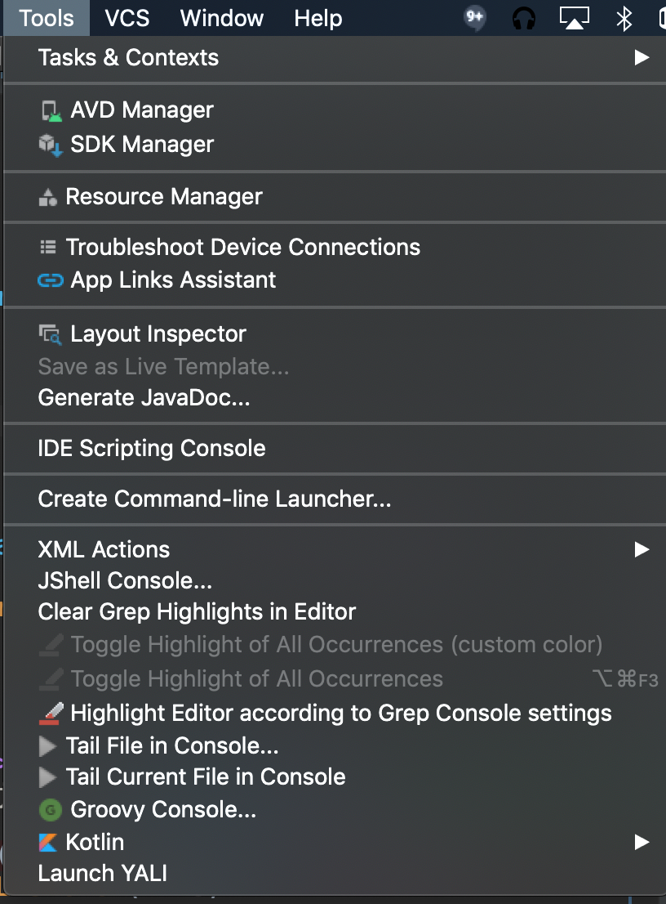
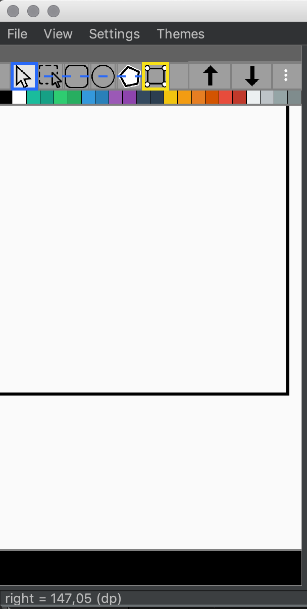

# Yet another android layout inspector

More stable Android Layout inspector than Android Studio Layout Inspector.
Allows you to switch between displaying dimensions in **PX** and **DP** (only for new layout captures, not for opened files)

## Download

Find [YALI](https://plugins.jetbrains.com/plugin/15227-yali) in AS plugins repository.

OR

1) [Download latest release](https://github.com/Grigory-Rylov/android-layout-inspector/releases)
2) Preferences -> Plugins -> Install plugin from Disk...
3) Select android-layout-inspector-plugin-{VERSION}.jar

## Getting started

Menu Tools -> Launch YALI

## Why Yet another android layout inspector?
Because AS layout inspector sometimes cannot download layouts for some reasons.
Also you can switch to *DP* dimension mode.

## Jetpack Compose
In the *New Layout* dialog select **jetpack compose (beta)**. Along with the regular view hierarchy YALI
downloads the real Compose tree from the running app (same App Inspection service Android Studio uses)
and grafts it under the `ComposeView` nodes:

- composable names, source file and line of every call;
- exact pixel bounds (the same PX/DP modes, distance measures and search work on compose nodes);
- the rendered text of every `Text` composable (tree label + `compose:text` property);

Requirements: the app is **debuggable** (debug build, without code shrinking), runs on the connected
device, and uses Compose UI 1.2.1+.
If the running process is invisible to App Inspection, YALI resets the on-device inspector
daemon (`/data/local/tmp/perfd` cache, transportd) and restarts the app automatically, the same
way Android Studio recovers its own process list. If the compose capture still fails (e.g. the
app is not debuggable), YALI shows the reason and the regular view hierarchy capture works as
before.

## Measure distance between two element
1) Select first element by **Mouse click** - it will be select by red square
2) Select second element by **Mouse click + Ctrl(Cmd)** - it will be select by yellow square.

In the status bar will shown distance between first and second

## Measure distance with ruler
1) Press **Shift** and move mouse to see where will be first point of ruler (black rectangle)
2) **Mouse click + Shift** to start ruler mode
3) **Mouse drag + Shift** to change ruler size
You will see ruler size in current units in status bar
 
## Hotkeys
### Files
**Ctrl + o** - Open file dialog

**Ctrl + n** - Record new layout

### Layout tree
**Ctrl + c** - Copy node name

**Ctrl + Shift + c** - Copy node ID

**Mouse click + Ctrl** - Select element to measure distance from selected to current.

**Mouse drag + Shift** - Measure ruler.

**Mouse right click** - Show distance from selected view to current point.
### Properties table
**Ctrl + c** - Copy property value

### Find
**Ctrl + f** - Open find dialog (type text and press **Enter**)

### Layouts
**z** - reset zoom to 100%
**f** - fit zoom to layout panel width

# Support me if you like YALI =)
**ETH ERC20 tokens** : `0x25Ca16AD3c4e9BD1e6e5FDD77eDB019386B68591`

**BNB BEP20 tokens** : `0x25Ca16AD3c4e9BD1e6e5FDD77eDB019386B68591`

**USDT TRC20** : `TSo3X6K54nYq3S64wML4M4xFgTNiENkHwC`

**BTC** : `bc1qmm5lp389scuk2hghgyzdztddwgjnxqa2awrrue`

https://www.tinkoff.ru/cf/4KNjR2SMOAj

# License

Yet another android layout inspector is released under the [Apache License, Version 2.0](LICENSE.txt).
